# Александр Епифанов — Flutter-разработчик (Middle+)

5 лет коммерческой разработки. 27 приложений: B2B-аналитика, логистика, мерчандайзинг, автосервис, HR, retail, e-commerce.

**Контакты:**
- Telegram: [@koh_alexander](https://t.me/koh_alexander)
- GitHub: [waslost0](https://github.com/waslost0)
- Email: marcus.koh16.01.97@gmail.com

---

## Ключевые проекты

### Hotel Advisors (2024–2026)

B2B-аналитика доходов отелей: KPI-метрики OTB, ADR, индексы TRGI/TORGI/TCRGI. 1000+ отелей, 100 000+ номеров.

**Что делал:**
- Разработал KPI-модуль: графики, таблицы, фильтры, сравнение с прошлым годом.
- Переключение между отелями и конкурентами, тултипы, экспорт данных.
- Старший разработчик проекта: архитектура, code review, релизы.
- App Store 4.9/5 (40 оценок).

**Стек:** Flutter, Provider, Hive, Firebase (Messaging, Analytics, Crashlytics, Remote Config), fl_chart, WebSocket.

**Ссылки:**
- [Google Play](https://play.google.com/store/apps/details?id=ru.hotel.advisor.app)
- [App Store](https://apps.apple.com/ru/app/id6547845540)

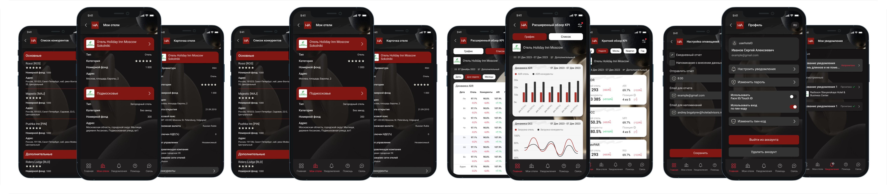

---

### Planeta Avto (2025–2026)

E-commerce автозапчастей: каталог, корзина, заказы, оплата.

**Что делал:**
- Ключевой разработчик: каталог, корзина, оформление заказов.
- Авторизация по звонку, push-трекинг, нативные события.
- iOS background modes, релизы в сторы.

**Стек:** Flutter, Provider, Hive CE, Firebase, WebSocket, geolocator, video_player.

**Ссылки:**
- [Google Play](https://play.google.com/store/apps/details?id=ru.planet.avto)
- [App Store](https://apps.apple.com/ru/app/id6778712210)

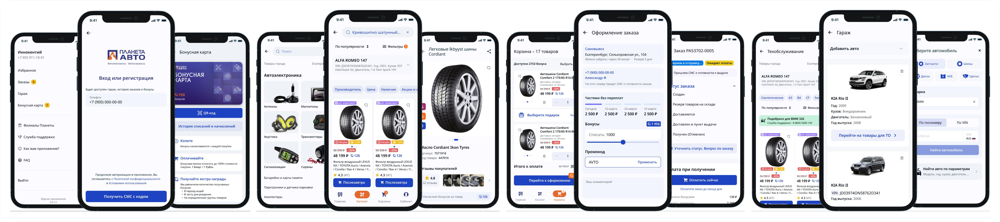

---

### Логистическая платформа (2026) `NDA — без скринов`

Логистика для курьеров: маршрутные листы, точки маршрута, грузы, офлайн-работа.

**Что делал:**
- Старший разработчик проекта.
- Маршрутные листы и точки, сканирование грузов (flutter_zxing), GPS.
- Foreground-сервис, полный офлайн, локальные уведомления.
- Генерация PDF, синхронизация при появлении сети.

**Стек:** Flutter, Provider, Hive CE, flutter_zxing, camera, geolocator, flutter_local_notifications, PDF.

---

### IAT Cars & Service (2021–2026)

Автосервис и дилеры: каталог автомобилей, тест-драйв, заявки.

**Что делал:**
- Каталог авто, запись на тест-драйв, подача заявок.
- Медиа: YouTube, Rutube, VK, Shorts.
- Разделы мото и дилеров, интеграции, релизы.
- App Store 4.4/5 (14 оценок).

**Стек:** Flutter, Provider, Hive CE, Firebase, WebView, video_player, geolocator.

**Ссылки:**
- [Google Play](https://play.google.com/store/apps/details?id=com.itsites.iat)
- [App Store](https://apps.apple.com/ru/app/id1538134096)

---

### HR-платформа для самозанятых (2025–2026) `NDA — без скринов`

Кабинет самозанятого: документы, чеки, договоры, взаимодействие с ФНС.

**Что делал:**
- Акты, чеки, договоры, разрешения ФНС.
- Чат, уведомления, профиль.
- Интеграция с бэкендом, мержи MR, релизы.

**Стек:** Flutter, Provider, Hive, Firebase, camera, geolocator, file_picker.

---

### Severcon (2026) `NDA — без скринов`

Климатическая техника: каталог, фильтры, подбор оборудования.

**Что делал:**
- Архитектура: typed GoRoute, Riverpod, Freezed.
- Каталог и фильтры, универсальные состояния загрузки, общие виджеты.
- Логирование запросов (talker + Dio), iOS flavors, CI.

**Стек:** Flutter, Riverpod, Freezed, GoRouter, Dio, Firebase.

---

## Другие проекты

### Promminer (2023–2025)

Майнинг-пул: мониторинг мощностей, 2FA.

**Что делал:**
- MVP за 2 месяца.
- Аутентификация с 2FA, графики, пуши.

**Стек:** Flutter, Provider, Hive, Dio, Firebase, fl_chart.

**Ссылки:**
- [Google Play](https://play.google.com/store/apps/details?id=ru.promminer.app)
- [App Store](https://apps.apple.com/ru/app/id6469705211)

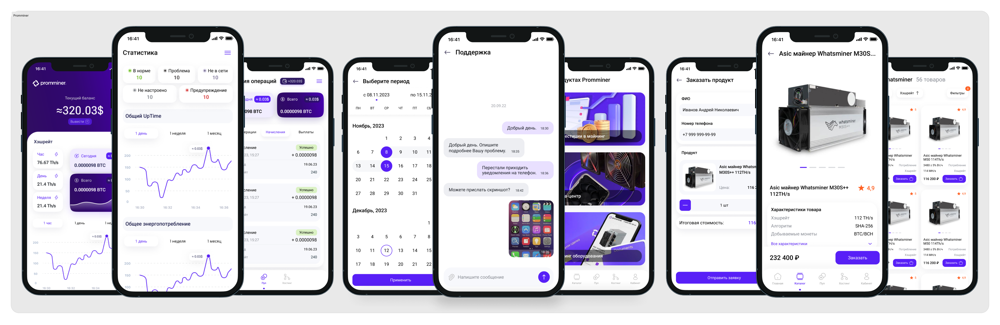

---

### Salegroup / Merch (2022–2026)

Полевой мерчандайзинг: отчёты, фото, офлайн.

**Что делал:**
- Модуль отчётов: формы, валидация, обработка файлов.
- Кастомная камера, аудиозапись, RTSP-камера.
- Полный офлайн с синхронизацией.

**Стек:** Flutter, Provider, Hive, Dio, Firebase, camera, just_audio, record, RTSP.

**Ссылки:**
- [Google Play](https://play.google.com/store/apps/details?id=ru.merch.app)
- [App Store](https://apps.apple.com/ru/app/id1348232526)

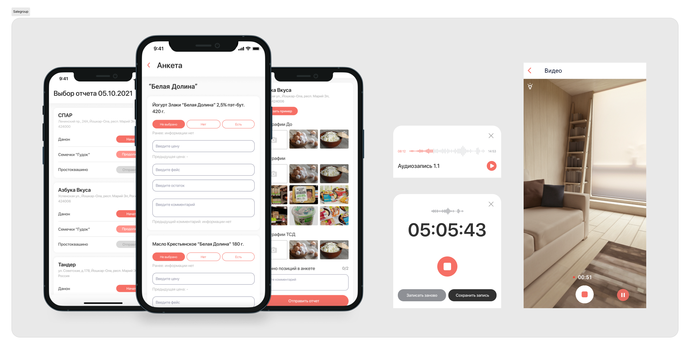

---

### Мой Ребенок (2021–2024)

Детское развитие: события, знания, марафоны.

**Что делал:**
- События и марафоны, база знаний.
- Аудио и чат, уведомления.

**Стек:** Flutter, Provider, Hive, Firebase, WebSocket, flutter_sound, just_audio.

**Ссылки:**
- [Google Play](https://play.google.com/store/apps/details?id=ru.mychild.app)

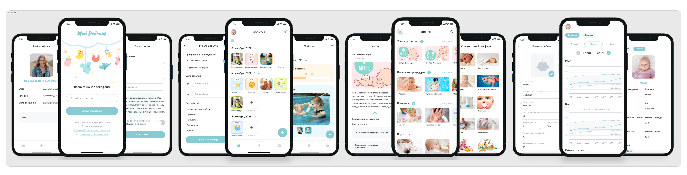

---

### The Бык (2023–2025)

Ресторан: акции, розыгрыши, подарки.

**Что делал:**
- Акции и розыгрыши, подарки, чат.
- Интеграции, релизы.

**Стек:** Flutter, Provider, Hive, Firebase, WebSocket.

**Ссылки:**
- [Google Play](https://play.google.com/store/apps/details?id=ru.thebull.app)
- [App Store](https://apps.apple.com/ru/app/id6473779473)

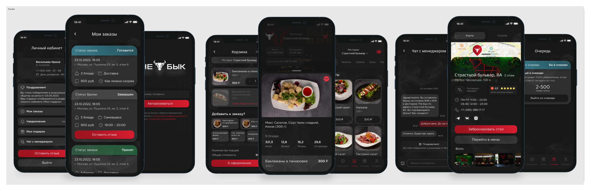

---

### ПланФакт (2022–2023)

Финансовый учёт: счета, контрагенты, операции, проекты.

**Что делал:**
- Счета и операции, проекты, локальные уведомления.

**Стек:** Flutter, Provider, Hive, Firebase, flutter_local_notifications.

**Ссылки:**
- [Google Play](https://play.google.com/store/apps/details?id=io.planfact.app)
- [App Store](https://apps.apple.com/ru/app/id1635100721)

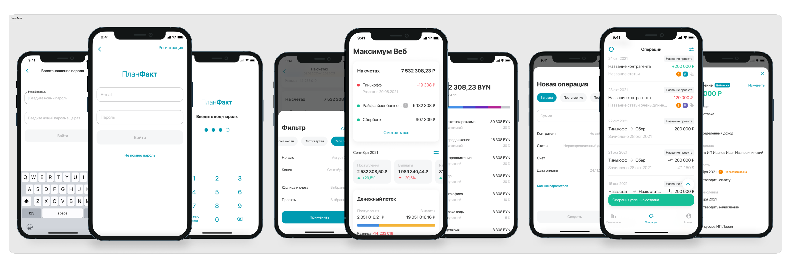

---

### OKVision (2021–2025)

Каталог продукции с QR-камерой.

**Что делал:**
- Каталог, QR-камера, избранное.

**Стек:** Flutter, Provider, Hive, Firebase, WebSocket, image_picker.

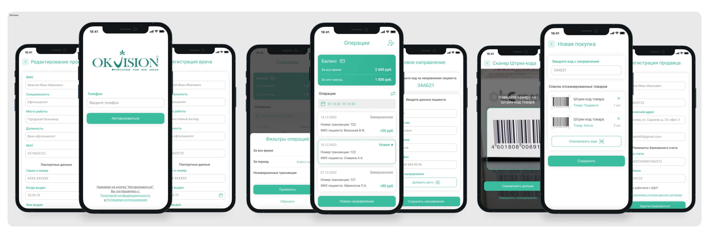

---

### Первый мясокомбинат / Доброгост (2023–2026)

Мясная продукция: каталог, заказ, доставка.

**Что делал:**
- Каталог и заказ, корзина, уведомления.

**Стек:** Flutter, Provider, Hive CE, Firebase, WebSocket.

**Ссылки:**
- [Google Play](https://play.google.com/store/apps/details?id=ru.firstmeat.app)
- [App Store](https://apps.apple.com/ru/app/id6471236889)

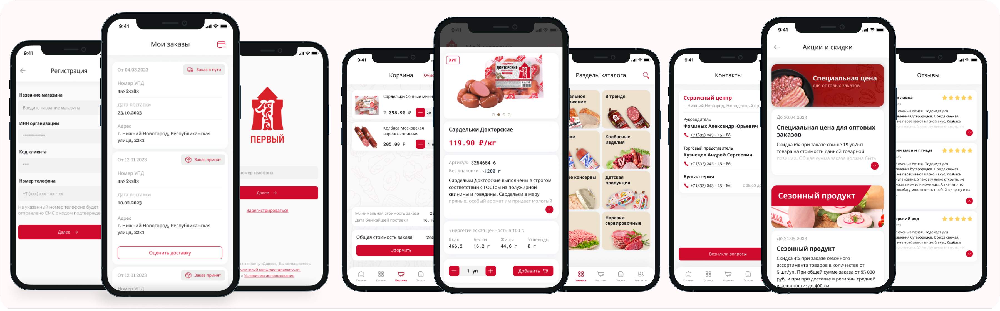

---

### Empire (2021–2026)

Недвижимость и новостройки: каталог, карта, чат.

**Что делал:**
- Кластеризация карты: 1000+ пинов, дифф-обновления, производительность.
- Каталог, push, авторизация по OTP, магазин.

**Стек:** Flutter, Provider, Hive CE, Firebase, fl_chart, video_player.

---

### Azhur (2021–2026)

Туры: бронирование, оплата, избранное.

**Что делал:**
- Бронирование и оплата, избранное, чат с медиа, карта.

**Стек:** Flutter, Provider, Elementary, Hive CE, GoRouter, Dio, Firebase, flutter_sound.

---

### Employee App (2021–2026)

HR-кабинет сотрудника.

**Что делал:**
- Начисления, договоры, патенты, документы, PDF.
- LMS-квизы, чат, миграция UIScene.

**Стек:** Flutter, Provider, Hive CE, Firebase, file_picker, share_plus.

---

### Cremory Market (2021–2026)

Продуктовый ритейл: каталог, самовывоз, бонусы.

**Что делал:**
- Каталог, корзина, самовывоз, бонусы.
- share_plus, форматирование телефонов, фиксы.

**Стек:** Flutter, Provider, Hive CE, GoRouter, Firebase, video_player.

---

### Gastronom (2026)

Продукты и доставка.

**Что делал:**
- Каталог, корзина, доставка.

**Стек:** Flutter, Provider, Hive CE, GoRouter, Firebase, geolocator.

**Ссылки:**
- [Google Play](https://play.google.com/store/apps/details?id=ru.gastronom.app)

---

### Dental Articles (2021–2026)

Стоматологическое образование: статьи, специалисты, опросы.

**Что делал:**
- Статьи, специалисты, опросы, медиа.

**Стек:** Flutter, Provider, Hive, Firebase, video_player.

**Ссылки:**
- [Google Play](https://play.google.com/store/apps/details?id=ru.dental.app)

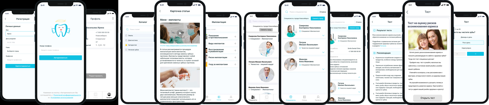

---

### Fabrica Bo (2026)

Фабрика: заказы, каталог, курьер.

**Что делал:**
- Каталог, заказы, курьерская доставка.

**Стек:** Flutter, Provider, Elementary, Hive CE, GoRouter, Dio, Firebase.

---

### Rehabilitation (2025–2026)

Реабилитация после операций.

**Что делал:**
- Анализы, календарь, дневник, фотоотчёты, чат.

**Стек:** Flutter, Provider, Hive, Firebase, image_picker, video_player.

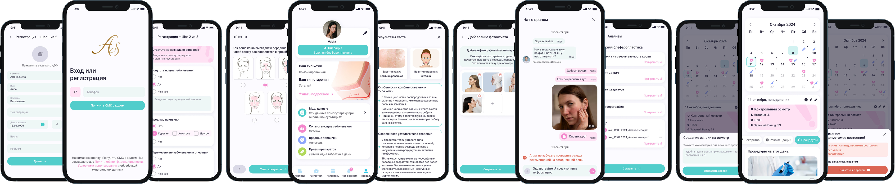

---

### Daylight (2025)

Стройматериалы: каталог, адреса, медиа.

**Что делал:**
- Каталог, адреса магазинов, медиа, чат.
- App Store 4.95/5 (19 оценок).

**Стек:** Flutter, Provider, Hive CE, Yandex MapKit, Firebase, WebSocket, record.

**Ссылки:**
- [Google Play](https://play.google.com/store/apps/details?id=ru.daylightliontex.app)
- [App Store](https://apps.apple.com/ru/app/id1550941926)

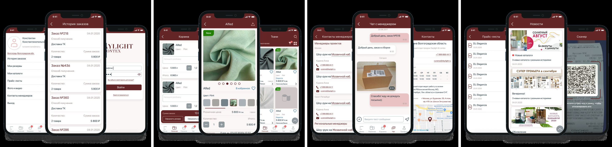

---

### Alliance (2025–2026)

B2B-опт: склад, счета.

**Что делал:**
- Заказы, склад, счета, поддержка плагина карт.

**Стек:** Flutter, Provider, Hive CE, GoRouter, Firebase, geolocator, file_picker.

**Ссылки:**
- [Google Play](https://play.google.com/store/apps/details?id=ru.allianceg.shop)
- [App Store](https://apps.apple.com/ru/app/id6812640108)

---

### APM Semicvetik (2021–2025)

B2B для флористов: сканирование, каталог.

**Что делал:**
- Скан-модуль, каталог, webview.

**Стек:** Flutter, Provider, HTTP, Firebase, кастомный scan-модуль.

---

### Nova Аптека (2021–2025)

Аптечная сеть: каталог, корзина, оплата.

**Что делал:**
- Магазин, новости, чат, профиль, интеграции, релизы.

**Стек:** Flutter, Provider, Hive, Yandex MapKit, Firebase, WebSocket.

**Ссылки:**
- [Google Play](https://play.google.com/store/apps/details?id=ru.nova.apteka)
- [App Store](https://apps.apple.com/ru/app/id6749004672)

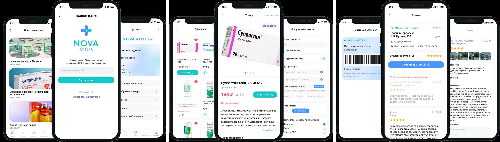

---

### Calipta (2021–2026)

Медицинская платформа: клиники, врачи, видеоконсультации.

**Что делал:**
- Запись и консультации, чат, навигация, интеграции, релизы.

**Стек:** Flutter, Provider, Hive CE, Firebase, WebSocket, video_player.

**Ссылки:**
- [Google Play](https://play.google.com/store/apps/details?id=ru.calipta.app)
- [App Store](https://apps.apple.com/ru/app/id6754246043)

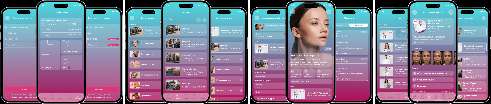

---

### Грузик (2022–2025)

Грузоперевозки: клиент/водитель, заявки, маршруты.

**Что делал:**
- Профиль, локализация, общие компоненты, поддержка.

**Стек:** Flutter, Provider, Google Maps, Firebase, WebSocket.

**Ссылки:**
- [Google Play](https://play.google.com/store/apps/details?id=ru.gruzik.app)
- [App Store](https://apps.apple.com/ru/app/id1552684145)

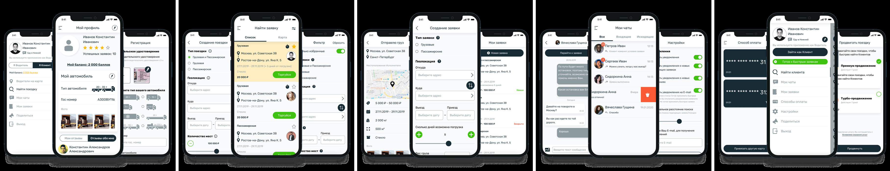
