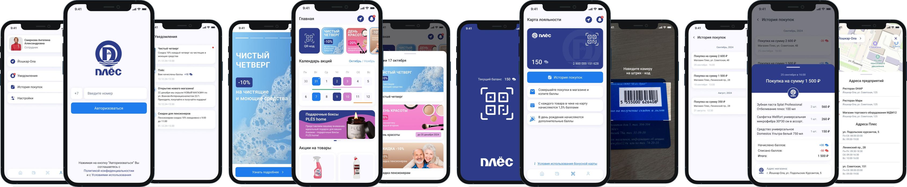
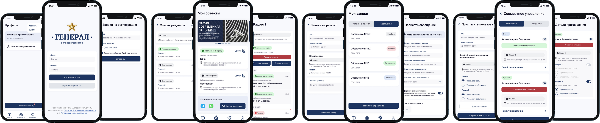
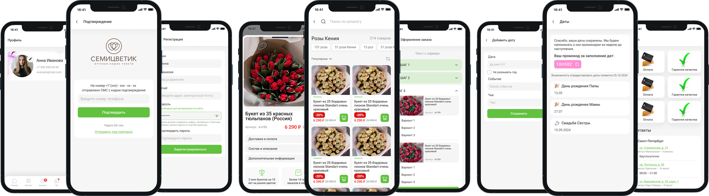
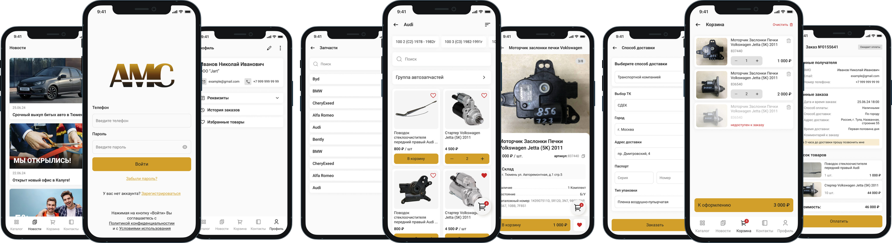

# Александр Епифанов — Flutter-разработчик (Middle+)

5 лет коммерческой разработки. 29 приложений: B2B-аналитика, логистика, мерчандайзинг, автосервис, HR, retail, e-commerce.

**Контакты:**
- Telegram: [@koh_alexander](https://t.me/koh_alexander)
- GitHub: [waslost0](https://github.com/waslost0)
- Email: alexkoh.x@gmail.com

---

## Ключевые проекты

### Hotel Advisors (2024–2026)

B2B-аналитика доходов отелей: KPI, графики, таблицы, карта отелей.

**Мой вклад:**
- Разработал KPI-модуль: OTB, ADR, индексы TRGI/TORGI/TCRGI, графики и таблицы.
- Фильтры, сравнение с прошлым годом, переключение между отелями и конкурентами.
- Карта отелей, тултипы, экспорт данных.
- Старший разработчик проекта: архитектура, code review, релизы.

**Стек:** Flutter, Provider, Hive, Firebase (Messaging, Analytics, Crashlytics, Remote Config), fl_chart, WebSocket.

**Ссылки:**
- [Google Play](https://play.google.com/store/apps/details?id=ru.hotel.advisor.app)
- [App Store](https://apps.apple.com/ru/app/id6547845540)

---

### Planeta Avto (2025–2026)

E-commerce автозапчастей: каталог, корзина, заказы, оплата, самовывоз.

**Мой вклад:**
- Ключевой разработчик: каталог по брендам, корзина, оформление заказов, самовывоз.
- Личный гараж, карта лояльности, адреса и пункты выдачи, города.
- Авторизация по звонку, push-трекинг, нативные события.
- iOS background modes, чат, релизы в сторы.

**Стек:** Flutter, Provider, Hive CE, Firebase, WebSocket, geolocator, video_player.

**Ссылки:**
- [Google Play](https://play.google.com/store/apps/details?id=ru.planet.avto)
- [App Store](https://apps.apple.com/ru/app/id6778712210)

---

### Логистическая платформа (2026) `NDA`

Логистика для курьеров: маршрутные листы, грузы, GPS, офлайн.

**Мой вклад:**
- Старший разработчик проекта.
- Маршрутные листы и точки, сканирование грузов (flutter_zxing), GPS.
- Foreground-сервис, полный офлайн, локальные уведомления.
- Генерация PDF, синхронизация при появлении сети.
- Собрал mock-бэкенд на FastAPI (маршрутные листы, грузы, GPS, JWT, админка) для тестирования приложения.

**Стек:** Flutter, Provider, Hive CE, flutter_zxing, camera, geolocator, flutter_local_notifications, PDF.

---

### IAT Cars & Service (2021–2026)

Автосервис и дилеры: каталог авто, тест-драйв, заявки, медиа.

**Мой вклад:**
- Каталог авто и брендов, карточки, избранное.
- Запись на тест-драйв, заявки, сервисные услуги.
- Медиа: YouTube, Rutube, VK, Shorts, сторис, новости.
- Разделы мото и дилеров, мой автомобиль.
- Интеграции, релизы, Huawei flavor.

**Стек:** Flutter, Provider, Hive CE, Firebase, WebView, video_player, geolocator.

**Ссылки:**
- [Google Play](https://play.google.com/store/apps/details?id=com.itsites.iat)
- [App Store](https://apps.apple.com/ru/app/id1538134096)

---

### HR-платформа для самозанятых (2025–2026) `NDA`

Кабинет самозанятого: документы, чеки, договоры, ФНС, поиск работы.

**Мой вклад:**
- Акты, чеки, договоры, разрешения ФНС.
- Поиск работы, приглашения, модерация.
- Паспорт и документы, адресная карта, чат, уведомления.
- Интеграция с бэкендом, мержи MR, релизы.

**Стек:** Flutter, Provider, Hive, Firebase, camera, geolocator, file_picker.

---

### Severcon (2026) `NDA`

Климатическая техника: каталог, фильтры, подбор оборудования.

**Мой вклад:**
- Архитектура: typed GoRoute, Riverpod, Freezed.
- Каталог и фильтры, универсальные состояния загрузки, общие виджеты.
- Логирование сетевых запросов, CI/CD.

**Стек:** Flutter, Riverpod, Freezed, GoRouter, Dio, Firebase.

---

## Другие проекты
### Salegroup / Merch (2022–2026)

Полевой мерчандайзинг: отчёты, фото, аудио, офлайн.

**Мой вклад:**
- Модуль отчётов: формы, валидация, обработка файлов.
- Кастомная камера, аудиозапись, RTSP-камера.
- Полный офлайн с синхронизацией.
- Расписание, каталог продуктов.

**Стек:** Flutter, Provider, Hive, Dio, Firebase, camera, just_audio, record, RTSP.

**Ссылки:**
- [Google Play](https://play.google.com/store/apps/details?id=ru.merch.app)
- [App Store](https://apps.apple.com/ru/app/id1348232526)

---

### Ples (2021–2026)

Система лояльности «Фирма Плёс»: бонусная карта, акции, сторис.

**Мой вклад:**
- Личный кабинет, бонусная карта, QR-код, сканер штрих-кода.
- Сториз, акции, промо, календарь акций, новости.
- Локации магазинов, уведомления.
- Интеграция с API 1С.

**Стек:** Flutter, Provider, Hive, Firebase, Yandex MapKit, WebSocket.

**Ссылки:**
- [Google Play](https://play.google.com/store/apps/details?id=ru.ples12.app)
- [App Store](https://apps.apple.com/ru/app/id6749142040)

---

### Платформа недвижимости (2021–2026) `NDA`

Недвижимость и новостройки: каталог ЖК, карта, чат.

**Мой вклад:**
- Кластеризация карты: 1000+ пинов, дифф-обновления, производительность.
- Каталог ЖК, фильтры, избранное.
- Застройщики и продавцы, реклама.
- Чат, push, авторизация по OTP.

**Стек:** Flutter, Provider, Hive CE, Firebase, fl_chart, video_player.

---

### Туристическая платформа (2021–2026) `NDA`

Туры и поездки: бронирование, оплата, избранное, чат.

**Мой вклад:**
- Туры, поездки, бронирование и оплата.
- Избранное, друзья, чат с медиа, карта.
- Опросы, снаряжение, детские туры.
- Уведомления, Huawei flavor.

**Стек:** Flutter, Provider, Elementary, Hive CE, GoRouter, Dio, Firebase, flutter_sound.

---

### Первый мясокомбинат / Доброгост (2023–2026)

Мясная продукция: каталог, заказ, доставка.

**Мой вклад:**
- Каталог товаров, корзина, заказ.
- Контакты, профиль, авторизация, уведомления.

**Стек:** Flutter, Provider, Hive CE, Firebase, WebSocket.

**Ссылки:**
- [Google Play](https://play.google.com/store/apps/details?id=ru.firstmeat.app)
- [App Store](https://apps.apple.com/ru/app/id6471236889)

---

### Продуктовый ритейл (2021–2026) `NDA`

Продуктовый ритейл: каталог, самовывоз, бонусы.

**Мой вклад:**
- Каталог, корзина, самовывоз, бонусы.
- Адреса магазинов, профиль, уведомления.
- Сборки, интеграции, релизы.

**Стек:** Flutter, Provider, Hive CE, GoRouter, Firebase, video_player.

---

### HR-кабинет сотрудника (2021–2026) `NDA`

HR-кабинет сотрудника: начисления, договоры, патенты, документы.

**Мой вклад:**
- Начисления, договоры, патенты, документы, PDF.
- LMS-квизы, чат, профиль.

**Стек:** Flutter, Provider, Hive CE, Firebase, file_picker, share_plus.

---

### Promminer (2023–2025)

Майнинг-пул: мониторинг мощностей, 2FA.

**Мой вклад:**
- Мониторинг мощностей и пула, графики, пуши.
- Аутентификация с 2FA.
- MVP за 2 месяца.

**Стек:** Flutter, Provider, Hive, Dio, Firebase, fl_chart.

**Ссылки:**
- [Google Play](https://play.google.com/store/apps/details?id=ru.promminer.app)
- [App Store](https://apps.apple.com/ru/app/id6469705211)

---

### Alliance (2025–2026)

B2B-опт: заказы, склад, счета, карта.

**Мой вклад:**
- Заказы, склад, счета.
- Карта, профиль, web-версия.
- Релизы, поддержка.

**Стек:** Flutter, Provider, Hive CE, GoRouter, Firebase, geolocator, file_picker.

**Ссылки:**
- [Google Play](https://play.google.com/store/apps/details?id=ru.allianceg.shop)
- [App Store](https://apps.apple.com/ru/app/id6812640108)

---

### Nova Аптека (2021–2025)

Аптечная сеть: каталог, корзина, оплата, карта аптек.

**Мой вклад:**
- Каталог, корзина, оформление и оплата заказов.
- Карта и список аптек, города.
- Бонусы и скидочная карта, отзывы, новости.
- Чат, профиль, уведомления.

**Стек:** Flutter, Provider, Hive, Yandex MapKit, Firebase, WebSocket.

**Ссылки:**
- [Google Play](https://play.google.com/store/apps/details?id=ru.nova.apteka)
- [App Store](https://apps.apple.com/ru/app/id6749004672)

---

### Calipta (2021–2026)

Медицинская платформа: клиники, врачи, запись, видеоконсультации.

**Мой вклад:**
- Клиники, врачи, услуги, запись и оплата.
- Видеоконсультации, мои консультации.
- Страховки, отзывы, медиагалерея, портфолио врачей.
- Чат, фильтры, AppMetrica.

**Стек:** Flutter, Provider, Hive CE, Firebase, WebSocket, video_player.

**Ссылки:**
- [Google Play](https://play.google.com/store/apps/details?id=ru.calipta.app)
- [App Store](https://apps.apple.com/ru/app/id6754246043)

---

### Gastronom (2026)

Продукты и доставка: каталог, корзина, заказ.

**Мой вклад:**
- Каталог, корзина, доставка.
- Профиль, авторизация, Huawei flavor.

**Стек:** Flutter, Provider, Hive CE, GoRouter, Firebase, geolocator.

---

### Генерал (2023–2026)

Охранное предприятие: объекты, сигнализация, заявки, доступ.

**Мой вклад:**
- Объекты: тревога, ремонт, снять с охраны.
- Заявки, совместное управление объектами.
- Новости, профиль, приглашения, обучение.

**Стек:** Flutter, Provider, Hive CE, Firebase, video_player.

**Ссылки:**
- [Google Play](https://play.google.com/store/apps/details?id=ru.securityagency.app)
- [App Store](https://apps.apple.com/ru/app/id6737612410)

---

### Мой Ребенок (2021–2024)

Детское развитие: события, марафоны, база знаний.

**Мой вклад:**
- События, марафоны, база знаний.
- Профили детей, метрики развития.
- Аудио, чат, уведомления, обучение.

**Стек:** Flutter, Provider, Hive, Firebase, WebSocket, flutter_sound, just_audio.

**Ссылки:**
- [Google Play](https://play.google.com/store/apps/details?id=ru.mychild.app)

---

### The Бык (2023–2025)

Ресторан: акции, розыгрыши, подарки, меню.

**Мой вклад:**
- Акции, розыгрыши, подарки.
- Меню и магазин, очередь, комментарии.
- Чат, новости, профиль, города.

**Стек:** Flutter, Provider, Hive, Firebase, WebSocket.

**Ссылки:**
- [Google Play](https://play.google.com/store/apps/details?id=ru.thebull.app)
- [App Store](https://apps.apple.com/ru/app/id6473779473)

---

### ПланФакт (2022–2023)

Финансовый учёт: счета, контрагенты, операции, проекты.

**Мой вклад:**
- Счета, контрагенты, операции по категориям, проекты.
- Справочники, локальные уведомления.
- Lock-экран, обучение.

**Стек:** Flutter, Provider, Hive, Firebase, flutter_local_notifications.

**Ссылки:**
- [Google Play](https://play.google.com/store/apps/details?id=io.planfact.app)
- [App Store](https://apps.apple.com/ru/app/id1635100721)

---

### OKVision (2021–2025)

Каталог продукции с QR-камерой и офлайн-режимом.

**Мой вклад:**
- Авто-кэширование API: GET-запросы кэшируются в Hive, работа офлайн, синхронизация при восстановлении сети.
- Каталог, поиск и фильтры, QR/штрих-сканер, избранное.
- Авторизация по телефону (SMS consent), push, обрезка фото, PDF-просмотр.

**Стек:** Flutter, Provider, Hive, Firebase, WebSocket, image_picker.

---

### Dental Articles (2021–2026)

Стоматологическое образование: статьи, специалисты, опросы.

**Мой вклад:**
- Статьи, специалисты, опросы.
- Медиа, профиль, авторизация.

**Стек:** Flutter, Provider, Hive, Firebase, video_player.

**Ссылки:**
- [Google Play](https://play.google.com/store/apps/details?id=ru.dental.app)

---

### Производственная платформа (2026) `NDA`

Фабрика: заказы, каталог, курьерская доставка.

**Мой вклад:**
- Каталог, заказы, курьерская доставка.
- Профиль, авторизация, Huawei flavor.

**Стек:** Flutter, Provider, Elementary, Hive CE, GoRouter, Dio, Firebase.

---

### Rehabilitation (2025–2026)

Реабилитация после операций: анализы, календарь, дневник.

**Мой вклад:**
- Анализы, календарь, дневник, фотоотчёты.
- Чат, опросы, профиль.

**Стек:** Flutter, Provider, Hive, Firebase, image_picker, video_player.

---

### Грузик (2022–2025)

Грузоперевозки: клиент/водитель, заявки, маршруты, оплата.

**Мой вклад:**
- Роли клиента и водителя, заявки, поездки.
- Автомобили, финансы, продвижение.
- Чат, отзывы, FAQ, настройки.

**Стек:** Flutter, Provider, Google Maps, Firebase, WebSocket.

**Ссылки:**
- [Google Play](https://play.google.com/store/apps/details?id=ru.gruzik.app)
- [App Store](https://apps.apple.com/ru/app/id1552684145)

---

### Семицветик (2021–2025)

Цветочный интернет-магазин: заказ и доставка цветов.

**Мой вклад:**
- Каталог, поиск, фильтры, корзина, оформление, онлайн-оплата.
- Заказы, чат, важные даты, контакты.
- Интеграция с API сайта.

**Стек:** Flutter, Provider, Hive, Firebase, yandex_mapkit_lite.

**Ссылки:**
- [Google Play](https://play.google.com/store/apps/details?id=ru.semicvetic.app)
- [App Store](https://apps.apple.com/ru/app/id6477922855)

---

### АМС72 (2023–2025)

Продажа б/у автозапчастей: авторазбор, каталог, заказы.

**Мой вклад:**
- Каталог, поиск, фильтры, избранное, корзина.
- Оформление, оплата, доставка, мои заказы.
- Города, контакты, новости, профиль.
- Интеграция с API сайта на Битрикс 24.

**Стек:** Flutter, Provider, Hive, Firebase, flutter_blurhash.

**Ссылки:**
- [Google Play](https://play.google.com/store/apps/details?id=ru.amc72.app)
- [App Store](https://apps.apple.com/ru/app/id6752297331)

